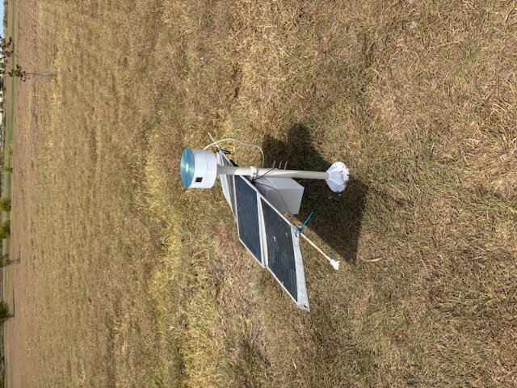
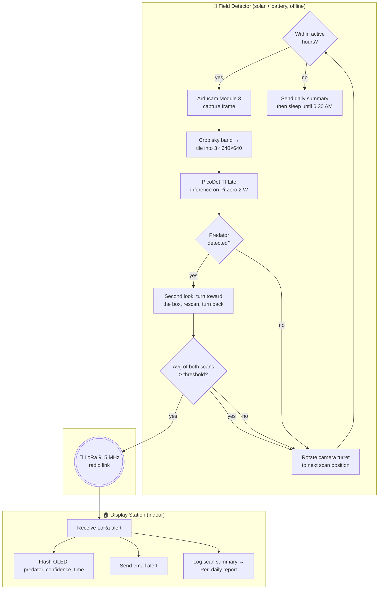

# SpotPredator

An AI-powered farm predator detection system built on Raspberry Pi Zero 2 W. SpotPredator uses a custom-trained PicoDet computer vision model to identify predators in real time, and alerts you wirelessly via LoRa radio — no internet required in the field with long range option. Free from monthly subscription plans.

---

## Overview

Farm animals face constant threats from hawks, eagles, foxes, coyotes, and other predators. SpotPredator provides an automated, low-cost, low-power monitoring solution that runs entirely offline in the field and notifies you at home the moment a threat is detected.

This is my first Raspberry Pi, computer vision, and soldering project — built from scratch with no prior hardware experience. There were cold joints, wrong pins, a buzzer that beeped all night, and a computer vision model that silently collapsed for two weeks before I caught it. I learned more from those mistakes than from anything that worked first try. The project is far from perfect — if you spot a bug, a better approach, or have suggestions, feel free to open an issue or pull request. Feedback is always welcome.

The system consists of two devices. Field detector code lives in `src/`, display station code lives in `display_station/`.

> 🎮 **Try the model live** — play with the latest predator detector in your browser (no setup):
> **https://huggingface.co/spaces/JZVince/spotpredator**

<p align="center">
  
  
  
</p>
<p align="center"><sub>
  Left: the field device. Middle and right: real detections from 12 Oct 2026 — a coyote taking a
  bird at 10:18 (95%), and the same coyote at 10:50, which the model labelled <i>fox</i> (85%).
</sub></p>


**Field Detector** — deployed outdoors near your animals
- Captures images continuously using an Arducam Camera Module 3
- Runs AI inference locally using a fine-tuned **PicoDet** object-detection TFLite model
- **Rotating camera turret** — a 28BYJ-48 stepper sweeps the camera through 5 positions
  (C, L1, L2, R1, R2) for near-360° coverage
- **Second-look check against false positives** — before alerting, the turret turns toward the
  detection, scans again, and only alerts if the two scans agree (see *How It Works*)
- Transmits alerts wirelessly to your home via LoRa radio, including **where** the predator was
  seen (e.g. `R2L` = right-2 position, left side of the view)
- Sends heartbeat status updates every 30 minutes, plus an end-of-day scan summary
- Operates on a configurable schedule (default 6:30 AM – 8:00 PM) — set the end time to dusk
- Saves raw scan images only for 5 minutes after a detection, so the SD card doesn't fill up
- Recovers from camera hangs on its own (service restart → full reboot → alert if still failing)
- **Solar + battery powered** — true off-grid operation, no WiFi required
- Housed in a **custom 3D-printed ABS enclosure** (field-validated through a Texas summer)

**Display Station** — sits indoors on your desk
- Receives LoRa alerts from the field device
- Shows predator type, confidence, location, and time on an OLED display — flashes on a new
  alert, then shows "seen N min ago" for 10 minutes
- Shows field errors (e.g. camera failure) for 1 hour, while still showing heartbeats so you can
  tell the field device is alive
- Sends you an immediate email alert on predator detection. If the internet is down, missed
  alerts are kept and sent as **one** catch-up email once it's back (no email bursts)
- Generates a Perl-based daily report right after the field device's end-of-day summary
  arrives (so it follows your end time), with an 11 PM fallback if the summary never arrives

---

## Hardware

### Both Devices
| Component | Details |
|-----------|---------|
| Raspberry Pi Zero 2 W | Main compute unit |
| microSD card | 32GB+ recommended |
| 5V 2.5A power supply | For indoor/bench use |
| RYLR998 LoRa Module | 915MHz (US) / 868MHz (EU), up to 15km range |

### Field Detector (additional)
| Component | Details |
|-----------|---------|
| Arducam Camera Module 3 | IMX708, autofocus, 12MP |
| 15-to-22 pin FFC cable | Required for Pi Zero camera connector |
| DS3231 RTC Module | Real-time clock with CR2032 battery |
| 12V LiFePO4 Battery (10Ah) | Field power supply |
| Solar charge controller (LiFePO4 mode, 5V USB output) | Charges the battery; its USB port powers the Pi |
| 30W solar panel | |
| 28BYJ-48 stepper + ULN2003 driver | Camera turret |

### Display Station (additional)
| Component | Details |
|-----------|---------|
| SSD1306 OLED Display | 128x64, I2C, 0.96 inch |
| SFM-27-W Piezo Buzzer | 3-27V, loud alarm |
| 2N2222 NPN Transistor | Buzzer drive circuit |
| 1kΩ resistor | Transistor base resistor |

---

## AI Model

SpotPredator uses a custom fine-tuned **PicoDet** object-detection model,
converted to TensorFlow Lite (FP16) for on-device inference on the Pi Zero 2 W.

- **Input**: 640x640 RGB image
- **Deployment classes**: `coyote`, `fox`, `raptor`
- **Confidence threshold**: 0.8 (configurable)
- **Runtime**: `tflite_runtime` / `ai-edge-litert` (CPU, XNNPACK)
- **Trained on**: author-collected field images + LILA BC + GBIF imagery

The model is published on Hugging Face (with usage code, classes, and limitations):
👉 **https://huggingface.co/JZVince/spotpredator-picodet**

Or try it interactively in your browser — upload an image and see the detections:
👉 **https://huggingface.co/spaces/JZVince/spotpredator**

**Small-object optimization**: predators often occupy only 20–40 px in a 1920×1080 frame.
The pipeline crops the sky band (keeping a 1920×640 ground strip) and tiles it into three
640×640 patches (left/middle/right) — so each patch gets the full resolution budget and
distant predators appear larger to the model. The same crop+tile is applied at training and
inference so the images match.

> **Model history / lesson learned**: This project started with an EfficientNetB0 classifier
> (`background`/`poultry`/`predator`), then moved to YOLO object detection, and finally to
> **PicoDet** — for better localization of small, distant animals and a permissive
> (Apache-2.0) license. The current model is a PicoDet trained locally with LibreYOLO; it
> outputs a single `[1, 8500, 7]` tensor (4 box coordinates + 3 class scores per anchor), which
> `src/detector.py` detects and decodes automatically. Key lesson: **before deploying, test your model on
> fresh local images and confirm reasonable output.** My original classifier was silently
> returning ~66% "background" for every scan for two weeks — I only noticed because I happened
> to check, not because anything failed (luckily no poultry were lost in that window).

---

## How It Works



**Second-look check:** a first-scan detection is not alerted right away. The turret turns about
22° toward where the box was (left tile → left, right tile → right, middle → one look each way),
scans again, and turns back. The alert is sent only if

```
(first-scan confidence + best second-scan confidence for the same animal) / 2  ≥  threshold
```

A real animal shows up again; a one-frame fluke (shadow, glare, a leaf) usually doesn't. At the
edge positions (L2/R2) the outward turn is limited to 5° to protect the camera cable. If the
camera fails during the second look, the alert is sent anyway. Rejected detections still count
in the daily summary's "detections by hour", and their second-look image is saved with a
`_verify` suffix so you can review what fooled the model.

**Heartbeat:** every 30 minutes the field device also sends a status heartbeat over LoRa so
the display station knows the system is alive. **No WiFi or internet is needed between the two
units** — all field-to-home communication is direct LoRa radio.

---

## Installation

### 1. Flash Raspberry Pi OS

Use [Raspberry Pi Imager](https://www.raspberrypi.com/software/) to flash **Raspberry Pi OS Lite (64-bit)** to your microSD card. Enable SSH and configure WiFi in the imager settings before flashing.

> **WiFi tip**: Raspberry Pi Zero 2 W only supports 2.4GHz WiFi. If you have trouble connecting, disable WiFi 6 mode and roaming assistant on your router, and separate your 2.4GHz and 5GHz networks.

### 2. Enable Required Interfaces

```bash
sudo raspi-config
```

Enable the following:
- Camera (libcamera) — field detector only
- I2C
- Serial Port — **disable serial console, keep serial hardware enabled**

Then reboot:
```bash
sudo reboot
```

### 3. Clone the Repository

```bash
git clone https://github.com/JZVince/spotpredator.git
cd spotpredator
```

### 4. Run the Setup Script

A setup script handles everything — dependencies, virtual environment, data directories, systemd service, and crontab.

**Field Detector:**
```bash
chmod +x scripts/setup_field.sh
./scripts/setup_field.sh
```

**Display Station:**
```bash
chmod +x scripts/setup_display.sh
./scripts/setup_display.sh
```

The display station script will prompt you for your Gmail address, App Password, and WiFi connection name during setup.

> To get a Gmail App Password: Google Account → Security → 2-Step Verification → App Passwords.
> To find your WiFi connection name: `nmcli connection show`

### 5. Configure the System

Edit `config.yaml` to match your setup:

```yaml
detector:
  confidence_threshold: 0.8     # Raise to reduce false positives

hardware:
  lora:
    frequency: 915              # 915 for US, 868 for EU
    network_id: 18              # Change if multiple LoRa networks nearby

detection:
  check_interval: 0             # Extra seconds between scan cycles (0 = as fast as the Pi allows)
  cooldown_period: 180          # Seconds before re-alerting same predator
  verify:
    enabled: true               # Second-look check before alerting
    shift_degrees: 22           # How far to turn toward the detection (~one tile)
    edge_shift_degrees: 5       # Max outward turn at L2/R2 (camera cable limit)
    invert_direction: false     # Set true if the second look turns AWAY from the animal
  schedule_enabled: true
  start_hour: 6                 # Start scanning at 6:30 AM
  start_minute: 30
  end_hour: 20                  # Stop scanning at 8:00 PM — set this to dusk where you are
  end_minute: 0
```

> Running with `check_interval: 0` keeps the Pi busy; in summer sun it can reach ~85°C and
> throttle (safe, just slower). Raise `check_interval` a few seconds if you want it cooler.

### 6. Place Your Trained Model

Copy your trained TFLite model and labels to the `models/` directory:

```
models/
├── predator_arm_b_mix_v4_fp16.tflite
└── labels.txt
```

You can download the published model from Hugging Face:
**https://huggingface.co/JZVince/spotpredator-picodet** (see the model card for the current file)

`labels.txt` contains the detection classes, one per line:
```
coyote
fox
raptor
```

> Only predators are labeled. Non-predators (background, people, poultry) are **negative
> instances** used during training — they carry no label and produce no detection.

### 7. Reboot

```bash
sudo reboot
```

The systemd service will start automatically on boot.

---

## Wiring

See [WIRING.md](WIRING.md) for full pin diagrams for both devices.

> **Soldering tip**: If soldering for the first time, flux is your best friend. It cleans metal surfaces, helps solder flow properly, and prevents cold joints.

---

## Troubleshooting

### Cannot SSH into Pi — connection refused or times out
- Before assuming hardware failure (SD card, cable, Pi itself), check your router first
- Pi Zero 2 W only supports **2.4GHz WiFi** — if your router broadcasts a combined 2.4/5GHz network, the Pi may fail to connect
- I'm not saying 5GHz won't work completely, but sure I had a lot issue with it.
- Disable **WiFi 6 (802.11ax)** mode on your router — Pi Zero 2 W does not support it
- Disable **roaming assistant** or **band steering** on your router — these features can kick pi devices out of connection due to low signal strength.
- Use **WPA2-Personal** (not the mixed WPA2/WPA3 mode), and set Protected Management Frames to **Disabled** or **Capable** (not Required)
- On ASUS routers, also turn off **Smart Connect**, **Target Wake Time**, and **WiFi Agile Multiband**
- A Pi that connects and then drops 1–2 minutes later is the classic sign one of these is still on
- **After a router factory reset, re-check all of the above** — a reset turns them all back on
- Separate your 2.4GHz and 5GHz into two distinct networks and connect the Pi to the 2.4GHz one explicitly. A lot older devices work the best with 2.4GHz, same result for my BambuLab Printer and regular printer.
- After changing router settings, re-flash the SD card with the correct WiFi credentials and try again

### Device reboots randomly
- If it reboots when the power plug is touched or wiggled, it's a loose USB power connector, not software
- Strain-relieve the cable (a cable gland on the enclosure) so it can't move the plug

### Camera not working
- Reseat the ribbon cable firmly — this is the most common cause
- A turret that twists the ribbon cable will eventually tear it — check for small tears near the connector
- Run `libcamera-hello` to test
- Enable camera in `raspi-config` and reboot

### LoRa not responding
- Verify VCC is on **Pin 17 (3.3V)**, not Pin 18 (GPIO)
- Check TX/RX are crossed between Pi and LoRa module
- Ensure serial console is disabled in `raspi-config`
- Both devices must use the same frequency and network ID

### RTC resetting to year 2000
- CR2032 battery contact is loose — press firmly and bend the spring contact
- Replace battery if old
- Reseat all RTC jumper wires

### Station Display Device WiFi not reconnecting
- Run `nmcli connection show` and verify autoconnect is `yes`
- Disable WiFi power saving: `sudo iw dev wlan0 set power_save off`
- Add `autoconnect-retries=0` to your `.nmconnection` file for unlimited retries

### Model producing identical confidence scores for every scan
- Test with a known image: does inference output change with different inputs?
- If probabilities are identical regardless of input — model has collapsed, retrain required
- Common causes of model collapse:
  - **Learning rate too high during fine-tuning** — destroys pretrained ImageNet weights early in training, leaving the model unable to generalize
  - **Too many background images** — if background heavily outnumbers other classes, the model learns to always predict background as a safe default
  - **Imbalanced dataset** — aim for roughly equal class sizes; background should be a small fraction (~10-15%) of total images
  - **Augmentation too aggressive** — heavy distortion during training can prevent the model from learning meaningful features
- Before deploying any retrained model, always test it locally with a few known images and confirm confidence scores change with different inputs

---

## Work in Progress

> 🚧 These features are still being built and are **not ready to use yet**. The code is in the
> repo, but expect it to change.

- **WiFi setup over LoRa** — send the field device new WiFi details from the display station
  over the LoRa radio (encrypted with a per-kit key), so the sealed field enclosure doesn't have
  to be opened to change networks. Stays switched off until a kit key is created
  (`scripts/make_kit_key.py`); detection works normally without it.
- **Web application** — a browser dashboard for viewing detections and device status, and for
  quicker installation and setup.

---

## Future Plans

- Keep growing the field-image dataset for better real-world accuracy
- Expand predator classes with more species-specific training data
- Add an absolute angle sensor (e.g. AS5600 magnetic encoder) so the turret always knows its
  exact position after a power loss — a limit switch was ruled out because searching for it
  would twist the camera cable
- Add a physical button on the display station to acknowledge and clear alerts
- Explore ESP32 as a lower-cost alternative for the display station

---

## License

**Project code, hardware, and 3D models:** MIT License — feel free to modify and adapt.

**AI model:** **Apache-2.0**. The detector is fine-tuned from
[PicoDet](https://github.com/PaddlePaddle/PaddleDetection) (Apache-2.0), and derivative models
inherit that permissive license — so the model is free to use, modify, and deploy commercially,
with attribution. (Earlier versions were based on Ultralytics YOLO, which is AGPL-3.0; the switch
to PicoDet removes any AGPL obligation.)

---

Built for protecting farm animals from predators using accessible, low-cost hardware and open-source AI.
